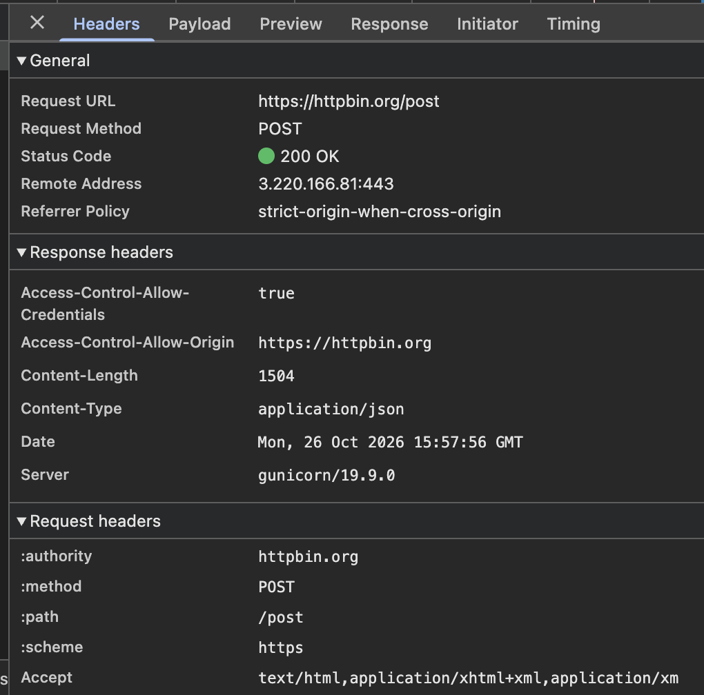
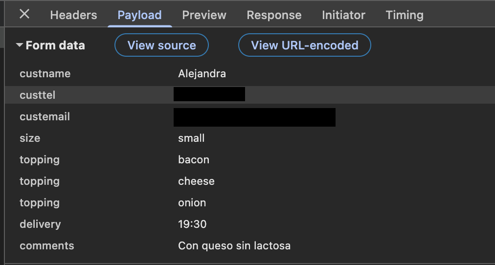
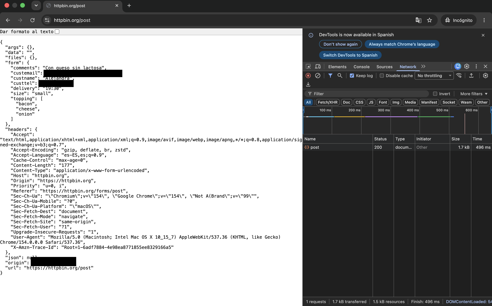
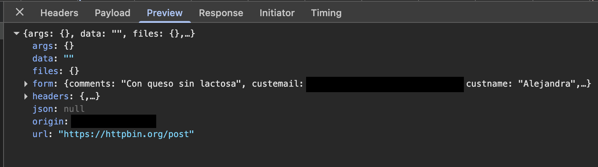
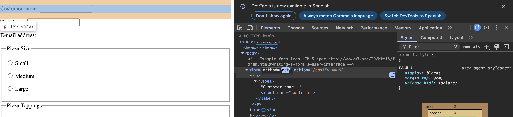
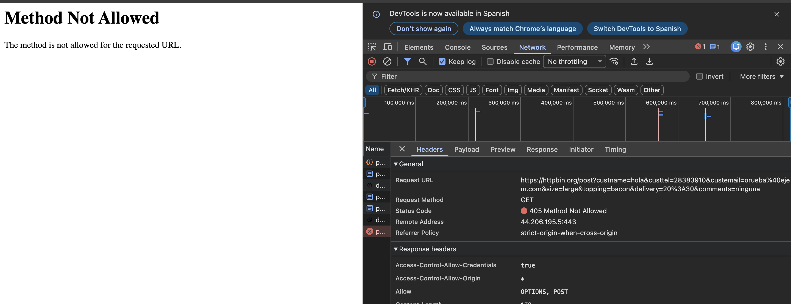

# Tema 2 · HTTP · Ejercicio 1

## Enunciado
- Busca una web que tenga un formulario (abre **navegación privada**).
- Analiza los mensajes HTTP que hay. ¿Identificas alguno?
- Rellena el formulario con cualquier dato y dale a *submit*.
- Analiza el mensaje HTTP que se ha generado con las herramientas del navegador.
- Repite los pasos **editando el HTML y cambiando el método**.

---

## Web y herramientas
- **Formulario:** [httpbin.org/forms/post](https://httpbin.org/forms/post). Es un formulario de prueba para pedir una pizza: nombre, teléfono, email, tamaño, ingredientes, hora de entrega y comentarios.
- **Navegador:** Google Chrome 154 en macOS, en modo **incógnito**.
- **Herramienta:** Chrome DevTools (F12), pestaña **Network** con **Keep log** activado para que no se borren las peticiones al cambiar de página.

> En las capturas he tapado mis datos personales (email, teléfono e IP).

---

## 1. Al cargar la página
Al entrar en `httpbin.org/forms/post` el navegador hace una petición **GET** para pedir el documento HTML del formulario, y el servidor responde **200 OK**. Es el caso más normal: **pedir** un recurso sin enviar datos.

El formulario está definido en el HTML así:

```html
<form method="post" action="/post">
  <p><label>Customer name: <input name="custname"></label></p>
  ...
</form>
```

- `method="post"` → al enviarlo se usará el método **POST**.
- `action="/post"` → los datos se enviarán a la URL **/post**.
- Cada campo tiene un `name` (`custname`, `custtel`, `custemail`…). Ese nombre es la «clave» con la que viaja cada dato.

---

## 2. Enviando el formulario con POST (método original)

He rellenado el formulario y he pulsado *Submit order*. En Network aparece una petición llamada **post**.

### Cabeceras


| Dato | Valor | Qué significa |
|---|---|---|
| Request URL | `https://httpbin.org/post` | A dónde se envían los datos. **La URL no lleva los datos** |
| Request Method | **POST** | Enviar datos al servidor para que los procese |
| Status Code | **200 OK** | ✅ El servidor ha recibido y procesado la petición |
| Remote Address | `…:443` | Puerto **443**, que es el de **HTTPS** (la conexión va cifrada) |

**Cabeceras de la petición** (las envía mi navegador):

| Cabecera | Valor | Qué significa |
|---|---|---|
| `Content-Type` | `application/x-www-form-urlencoded` | El cuerpo va en formato de formulario: `clave=valor&clave=valor` |
| `Content-Length` | `177` | El cuerpo ocupa 177 bytes |
| `Host` | `httpbin.org` | El servidor al que va dirigida la petición |
| `Origin` / `Referer` | `https://httpbin.org/forms/post` | Desde qué página se ha enviado |
| `User-Agent` | `Mozilla/5.0 (Macintosh; Intel Mac OS X 10_15_7) … Chrome/154 …` | Quién hace la petición: Chrome en un Mac |
| `Accept-Language` | `es-ES,es;q=0.9` | Prefiero el contenido en español |
| `Accept-Encoding` | `gzip, deflate, br, zstd` | Acepto la respuesta comprimida en esos formatos |

**Cabeceras de la respuesta** (las envía el servidor):

| Cabecera | Valor | Qué significa |
|---|---|---|
| `Content-Type` | `application/json` | La respuesta **no es una página HTML**, son **datos en JSON** |
| `Content-Length` | `1504` | La respuesta ocupa 1504 bytes |
| `Server` | `gunicorn/19.9.0` | El programa que hace de servidor (un servidor web de Python) |
| `Date` | `Mon, 26 Oct 2026 15:57:56 GMT` | Cuándo respondió |

### Dónde van los datos: en el cuerpo


En la pestaña **Payload** se ven los datos del formulario (*Form data*): `custname`, `custtel`, `custemail`, `size=small`, tres `topping` (bacon, cheese, onion), `delivery=19:30` y `comments`. **Van en el cuerpo de la petición**, por eso no aparecen en la barra de direcciones, que solo muestra `httpbin.org/post`.

Si se pulsa *View source*, el cuerpo se ve tal y como viaja: `custname=...&custtel=...&size=small&topping=bacon&topping=cheese&...`

### La respuesta



httpbin es un **servicio web**: en vez de devolver una página, **me devuelve en JSON** todo lo que le he enviado. Está en `form` (mis datos), en `headers` (las cabeceras que mandó mi navegador) y en `origin` (mi IP).

---

## 3. Cambiando el método a GET

### Editar el HTML
Con clic derecho → **Inspeccionar** sobre el formulario, en la pestaña **Elements**, he cambiado `method="post"` por `method="get"` haciendo doble clic en el valor.



> Este cambio solo se hace **en mi copia de la página en el navegador**. El servidor no se entera, y al recargar la página vuelve a estar como antes.

### Volver a enviar
He rellenado otra vez el formulario (con datos inventados) y lo he enviado.


**Ahora los datos aparecen en la barra de direcciones**, en la parte *query* de la URL, después del `?`:

```
httpbin.org/post?custname=hola&custtel=28383910&custemail=orueba%40ejem.com&size=large&topping=bacon&delivery=20%3A30&comments=ninguna
```

- Cada campo va como `nombre=valor` y se separan con `&`.
- Algunos caracteres se **codifican** porque no pueden ir tal cual en una URL: la `@` se convierte en `%40` y los `:` de la hora en `%3A`.



| Dato | Valor |
|---|---|
| Request Method | **GET** |
| Status Code | ❌ **405 Method Not Allowed** |
| Cabecera de respuesta `Allow` | `OPTIONS, POST` |

### ¿Por qué responde 405?
El **405 Method Not Allowed** es un error **4xx**, es decir, un **error del cliente**: la petición que ha hecho mi navegador no es válida para ese recurso. En concreto, **la URL `/post` existe, pero el servidor no admite el método GET en ella**. La propia respuesta lo dice en la cabecera **`Allow: OPTIONS, POST`**: en `/post` solo se puede usar OPTIONS o POST.

No es un 404 (la URL sí existe) ni un 5xx (el servidor funciona bien). El problema es el **método** que he usado.

---

## Conclusiones
- **Con POST los datos van en el cuerpo** de la petición, y **con GET van en la URL**, a la vista de cualquiera y guardados en el historial. Por eso **nunca se deben enviar contraseñas con GET**.
- Las DevTools (pestaña **Network**) permiten ver cada petición HTTP: método, URL, código de estado, cabeceras y cuerpo.
- El **servidor decide qué métodos acepta** en cada URL. Si usas otro, responde **405** y te indica en la cabecera `Allow` cuáles valen.
- Cambiar el HTML en el navegador es muy fácil: cualquiera puede manipular lo que envía. Por eso **el servidor nunca debe fiarse del cliente** y tiene que comprobarlo todo (tema 1).
