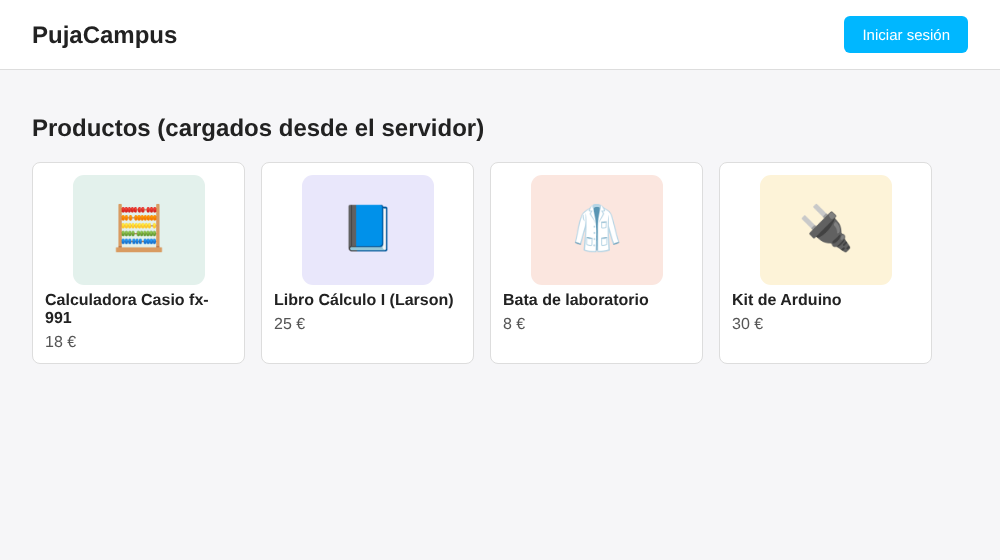
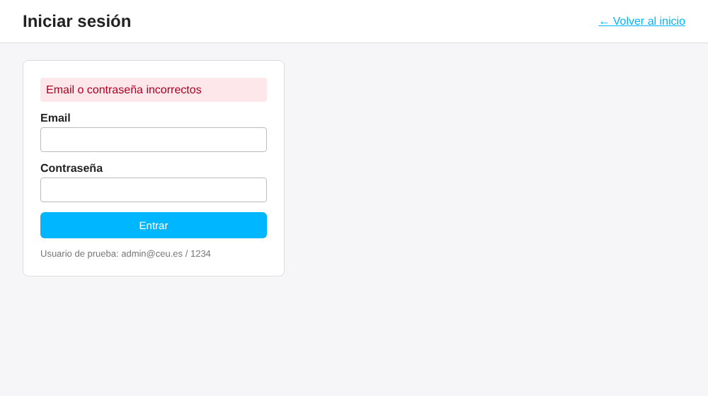
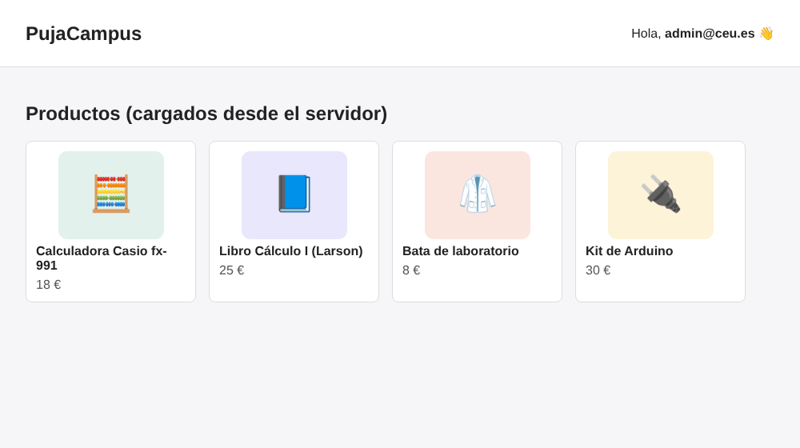

# Tema 6 · Node.js · Ejercicio 5 (Express Generator)

## Enunciado
- Crea un proyecto nuevo usando **express-generator**.
- Crea una página inicial que tenga:
  - Una lista de elementos que se carguen **desde el servidor** (imágenes, array de texto…).
  - Un botón para hacer login.
- Crea una página que sea login.

## Resultado

| Inicio (lista desde el servidor) | Login con error | Login correcto |
|---|---|---|
|  |  |  |

Usuario de prueba: **admin@ceu.es** / **1234**

---

## Cómo arrancarlo
Tienes que tener instalado [Node.js](https://nodejs.org) (la versión LTS). Después, desde la terminal:

```bash
cd tema-06-nodejs/ejercicio-5
npm install          # descarga las dependencias en node_modules/ (solo la primera vez)
npm start            # arranca el servidor
```

Luego abre **http://localhost:3000** en el navegador. Para pararlo, pulsa `Ctrl + C` en la terminal.

> Cada vez que cambies un archivo `.js` hay que parar y volver a arrancar el servidor (`Ctrl + C` y `npm start`). Los `.ejs` y `.css` se recargan solos.

---

## Cómo lo he hecho, paso a paso

### 1. Generar el proyecto
```bash
npx express-generator -v ejs ejercicio-5
```
- `npx` ejecuta un paquete de npm sin instalarlo.
- `express-generator` crea el esqueleto de una aplicación Express.
- `-v ejs` indica que las vistas usarán **EJS** (HTML con trocitos de JavaScript).
- `ejercicio-5` es el nombre de la carpeta que se crea.

### 2. Qué ha creado y para qué sirve cada cosa
```
ejercicio-5/
├── app.js              ← el "cerebro": configura Express y conecta todas las piezas
├── bin/www             ← arranca el servidor HTTP en el puerto 3000 (no se toca)
├── package.json        ← nombre del proyecto, dependencias y el script "npm start"
├── public/             ← archivos ESTÁTICOS: se envían tal cual al navegador
│   ├── images/
│   ├── javascripts/
│   └── stylesheets/style.css
├── routes/             ← las RUTAS: qué responde el servidor a cada URL + método
│   ├── index.js
│   └── users.js
└── views/              ← las PLANTILLAS EJS que se convierten en HTML
    ├── index.ejs
    └── error.ejs
```

**El recorrido de una petición** (por ejemplo, cuando entras en `http://localhost:3000/`):

1. El navegador envía `GET /` (tema 2).
2. `bin/www` la recibe y se la pasa a `app.js`.
3. `app.js` la pasa por los **middleware** (logger, lectura de formularios, cookies…). Primero mira si es un archivo de `public/`. Como no lo es, la manda al router: `app.use('/', indexRouter)`.
4. En `routes/index.js`, `router.get('/', ...)` hace `res.render('index', { datos })`.
5. Express coge `views/index.ejs`, **sustituye las variables** por los datos y envía el **HTML** resultante.
6. El navegador lo pinta y pide aparte el CSS y las imágenes, que salen de `public/`.

### 3. Lista de elementos desde el servidor (`routes/index.js`)
Creo un array con los productos **en el servidor** y se lo paso a la vista:

```js
const productos = [
  { nombre: 'Calculadora Casio fx-991', precio: 18, imagen: '/images/calculadora.svg' },
  ...
];

router.get('/', function(req, res, next) {
  res.render('index', { title: 'PujaCampus', productos: productos, usuario: null });
});
```

En la vista (`views/index.ejs`) recorro el array con un bucle de EJS:

```ejs
<% productos.forEach(function(producto) { %>
  <li>
    " alt="<%= producto.nombre %>">
    <span><%= producto.nombre %></span>
    <span><%= producto.precio %> €</span>
  </li>
<% }); %>
```

| Etiqueta EJS | Qué hace |
|---|---|
| `<% código %>` | **Ejecuta** JavaScript sin pintar nada (bucles, `if`) |
| `<%= variable %>` | **Pinta** el valor en el HTML (escapando caracteres peligrosos) |
| `<%# comentario %>` | Comentario: no aparece en el HTML |

> Si haces clic derecho → *Ver código fuente* en el navegador, **no verás nada de EJS**: solo HTML normal con los productos ya escritos. La plantilla se procesa **en el servidor**.

### 4. Botón de login
En `index.ejs` es un simple enlace a la ruta `/login`. Si el usuario ya ha iniciado sesión, en su lugar aparece un saludo:

```ejs
<% if (usuario) { %>
  <p>Hola, <strong><%= usuario %></strong></p>
<% } else { %>
  <a class="boton" href="/login">Iniciar sesión</a>
<% } %>
```

### 5. Página de login: dos rutas para la misma URL
| Petición | Qué hace |
|---|---|
| `GET /login` | **Muestra** el formulario (`views/login.ejs`) |
| `POST /login` | **Recibe** los datos del formulario y los comprueba |

El formulario usa `method="post"`, así que los datos viajan **en el cuerpo** (lo vimos en el ejercicio 1 de HTTP). En `app.js`, la línea `app.use(express.urlencoded(...))` convierte ese cuerpo en el objeto **`req.body`**. Cada campo llega con el `name` de su `<input>`:

```js
router.post('/login', function(req, res, next) {
  const email = req.body.email;        // <input name="email">
  const password = req.body.password;  // <input name="password">

  if (email === USUARIO.email && password === USUARIO.password) {
    res.render('index', { ..., usuario: email });          // ✅ correcto
  } else {
    res.status(401).render('login', { error: '...' });     // ❌ 401 Unauthorized
  }
});
```

---

## Limitaciones (lo que falta para un login de verdad)
- **No se recuerda la sesión.** Si recargas la página después de entrar, vuelves a estar sin sesión. HTTP es **sin estado** (tema 2), así que hace falta una **cookie de sesión**. Es lo que añade la demo de login del profesor con `express-session` y lo que se usa en el ejercicio 6.
- El usuario y la contraseña están **escritos en el código**. En una aplicación real estarían en una **base de datos** y la contraseña iría **cifrada** (hash).
